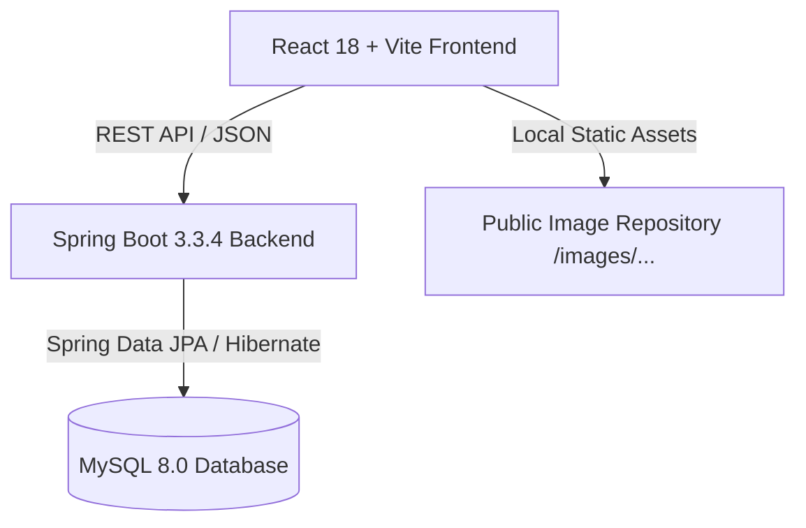

# SmartPick — Smart Product Recommendation Engine & AI Chatbot

SmartPick is a full-stack e-commerce recommendation platform built with **React + Vite**, **Java 21 Spring Boot**, and **MySQL**. It features dynamic multi-attribute product filtering across 4 categories and an integrated natural-language AI recommendation assistant powered by the backend filtering engine.

---

## 🚀 Features

- **180 Verified Products Across 4 Categories:**
  - 💻 **100 Laptops:** Entry-level to high-end gaming and ultrabooks (ASUS, HP, Lenovo, Acer, Apple, Dell, MSI, Samsung, etc.)
  - 📱 **30 Mobile Phones:** Budget, mid-range, and flagship devices (Samsung, Apple, OnePlus, Xiaomi, Redmi, Realme, Vivo, OPPO, Motorola, iQOO, Google Pixel, etc.)
  - 📺 **30 Smart TVs:** HD, Full HD, 4K UHD, QLED, and OLED TVs from 32" to 75" (Samsung, LG, Sony, Xiaomi, TCL, Hisense, Acer, Vu, etc.)
  - ⌚ **20 Smartwatches:** Fitness bands, Bluetooth calling, GPS-enabled, and premium smartwatches (Apple, Samsung, boAt, Noise, Garmin, Amazfit, OnePlus, Redmi, Realme)
- **Deep Multi-Attribute Filtering:** Category-aware filter panels supporting brand, price slider, processor, RAM, storage, GPU, display size, screen resolution, GPS capability, and battery life.
- **AI Recommendation Chatbot:** Conversational assistant that parses user prompts (e.g., *"Find Samsung 55-inch 4K TVs under ₹60,000"*), maps requirements to backend filter parameters, and displays real product cards with live specs, ratings, and image previews.
- **Local Asset Architecture:** 180 local product images served directly from `frontend/public/images/` with fallback image handling.

---

## 🏗️ Architecture & Tech Stack



- **Frontend:** React 18, Vite, Lucide Icons, Vanilla CSS
- **Backend:** Spring Boot 3.3.4, Java 21, Spring Data JPA, Hibernate, Maven
- **Database:** MySQL 8.0+ (`smartpick` schema, InnoDB, utf8mb4)

---

## 📁 Project Directory Structure

```text
SmartPick/
├── .gitignore                                      # Comprehensive gitignore (secrets, build, node_modules)
├── README.md                                       # Documentation & setup instructions
├── database/                                       # SQL scripts & data manifests
│   ├── smartpick_schema_and_seed_180.sql           # Master schema & 180-product seed script
│   ├── PRODUCT_IMAGE_MANIFEST.csv                  # Image to product mapping manifest
│   ├── seed_80_products.sql                        # Incremental seed for 80 non-laptop products
│   ├── update_image_urls_from_manifest.sql         # Manifest image updater
│   └── SmartPick_Update_100_Laptop_Images.sql      # Laptop image paths script
├── backend/                                        # Spring Boot 3 application
│   ├── pom.xml                                     # Maven dependencies (Java 21, MySQL, Spring Web/JPA)
│   ├── mvnw / mvnw.cmd                             # Maven wrapper scripts
│   └── src/main/
│       ├── java/com/smartpick/
│       │   ├── SmartpickBackendApplication.java    # Application entry point & CORS configuration
│       │   ├── controller/ProductController.java   # REST API endpoints for products & brands
│       │   ├── model/Product.java                  # JPA entity with all category fields
│       │   ├── repository/ProductRepository.java   # Dynamic query specification repository
│       │   └── service/ProductService.java         # Multi-criteria filtering business logic
│       └── resources/
│           ├── application.properties.example      # Template properties (commit-safe)
│           └── application.properties              # Local properties (gitignored)
└── frontend/                                       # React + Vite application
    ├── index.html                                  # HTML root
    ├── package.json                                # NPM dependencies & scripts
    ├── vite.config.js                              # Vite build configuration
    ├── public/images/                              # Local product image assets
    │   ├── laptops/                                # 100 laptop images (laptop-001.jpg ... laptop-100.jpg)
    │   ├── mobiles/                                # 30 mobile images
    │   ├── tvs/                                    # 30 smart TV images
    │   └── watches/                                # 20 smartwatch images
    └── src/
        ├── App.jsx                                 # Main UI, category tabs, filter drawer, AI chatbot
        ├── App.css                                 # Modern glassmorphism & responsive styling
        └── main.jsx                                # React DOM entry point
```

---

## ⚙️ Prerequisites

Before running the application, make sure you have the following installed:

1. **Java Development Kit (JDK) 21** or higher:
   ```bash
   java -version
   ```
2. **Node.js (v18.x or v20.x+) and npm**:
   ```bash
   node -v
   npm -v
   ```
3. **MySQL Server 8.0+**:
   ```bash
   mysql --version
   ```
4. **Git**:
   ```bash
   git --version
   ```

---

## 🛠️ Step-by-Step Setup Guide

### 1. Database Setup

1. Open your MySQL client (MySQL CLI, MySQL Workbench, or DBeaver).
2. Execute the master schema and seed script located in `database/smartpick_schema_and_seed_180.sql`:

   ```bash
   mysql -u root -p < database/smartpick_schema_and_seed_180.sql
   ```

3. Verify that all 180 products are seeded:
   ```sql
   USE smartpick;
   SELECT category, COUNT(*) FROM products GROUP BY category;
   ```
   Expected output:
   - `Laptop`: 100
   - `Mobile`: 30
   - `TV`: 30
   - `Smartwatch`: 20

---

### 2. Backend Setup (Spring Boot)

1. Navigate to the `backend` folder:
   ```bash
   cd backend
   ```
2. Create your local `application.properties` from the example template:
   - **Windows (PowerShell):**
     ```powershell
     Copy-Item src/main/resources/application.properties.example src/main/resources/application.properties
     ```
   - **macOS / Linux:**
     ```bash
     cp src/main/resources/application.properties.example src/main/resources/application.properties
     ```
3. Edit `src/main/resources/application.properties` with your MySQL credentials:
   ```properties
   spring.datasource.url=jdbc:mysql://localhost:3306/smartpick?useSSL=false&serverTimezone=UTC&allowPublicKeyRetrieval=true
   spring.datasource.username=YOUR_MYSQL_USERNAME
   spring.datasource.password=YOUR_MYSQL_PASSWORD
   server.port=8080
   ```
4. Build and start the backend:
   - **Windows:**
     ```powershell
     .\mvnw.cmd spring-boot:run
     ```
   - **macOS / Linux:**
     ```bash
     ./mvnw spring-boot:run
     ```
5. Verify the backend is active at: `http://localhost:8080/api/products`

---

### 3. Frontend Setup (React + Vite)

1. Open a new terminal and navigate to the `frontend` folder:
   ```bash
   cd frontend
   ```
2. Install dependencies:
   ```bash
   npm.cmd install
   # or 'npm install' on Linux/macOS
   ```
3. Start the development server:
   ```bash
   npm.cmd run dev
   # or 'npm run dev' on Linux/macOS
   ```
4. Open your browser and navigate to:
   ```text
   http://localhost:5173
   ```

---

## 📡 REST API Reference

| Method | Endpoint | Description | Query Parameters |
|--------|----------|-------------|------------------|
| `GET` | `/api/products` | Retrieve filtered products | `category`, `brand`, `minPrice`, `maxPrice`, `processor`, `ramGb`, `storageGb`, `gpu`, `minDisplaySize`, `maxDisplaySize`, `minRating`, `resolution`, `hasGps`, `minBatteryLifeDays`, `minBatteryWh` |
| `GET` | `/api/products/{id}` | Get product by ID | — |
| `GET` | `/api/products/categories` | List distinct product categories | — |
| `GET` | `/api/products/brands` | List brands for a given category | `category` (optional) |

---

## 📦 Building for Production

### Frontend Production Build
```bash
cd frontend
npm.cmd run build
```
The optimized production bundle will be generated in `frontend/dist/`.

### Backend Production Build
```bash
cd backend
.\mvnw.cmd clean package -DskipTests
```
The runnable executable JAR will be generated in `backend/target/smartpick-backend-0.0.1-SNAPSHOT.jar`.

To run the standalone JAR:
```bash
java -jar backend/target/smartpick-backend-0.0.1-SNAPSHOT.jar
```

---

## 🔒 Security & Git Hygiene

- `application.properties` containing database passwords is automatically ignored via `.gitignore`.
- Always use `application.properties.example` as a template for new deployments.
- Build artifacts (`target/`, `node_modules/`, `dist/`), OS files, and IDE settings are excluded from version control.
